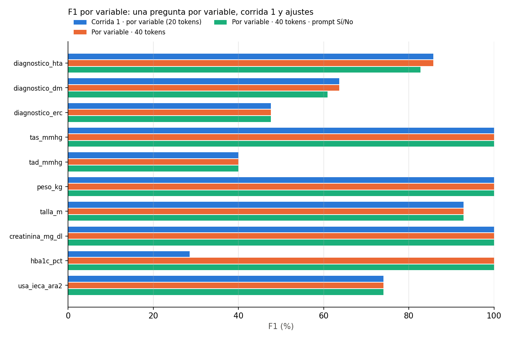
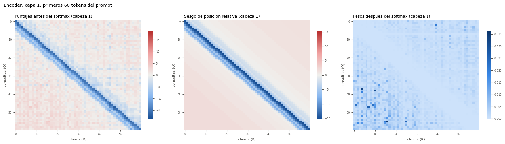
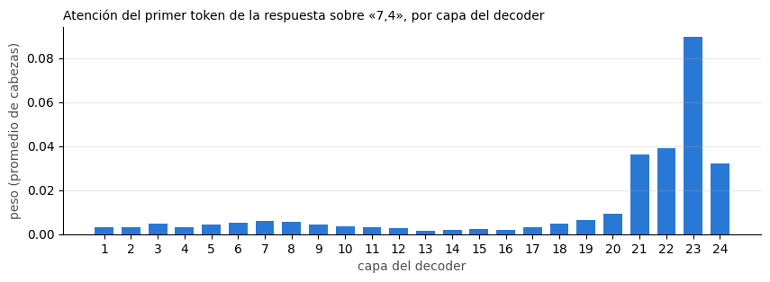
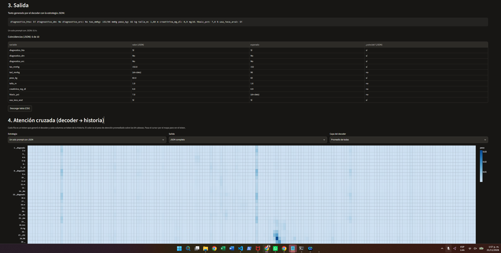

# Extracción de variables de riesgo cardiovascular con Aya-101

Trabajo final de Procesamiento de Datos Secuenciales (Maestría). Grupo 11: Joan Sebastian Mena Ortega y Jensen Tamayo Merchan.

Las historias clínicas de `ejemplos_hc/` son sintéticas. Todos sus datos son ficticios.

## 1. Resumen

Aplicamos **Aya-101**, un Transformer encoder-decoder de 13B parámetros basado en mT5, a la extracción de 10 variables de la cohorte de riesgo cardiovascular de la CAC desde historias clínicas en español, sin entrenarlo. El modelo corre en una GPU T4 de Google Colab cuantizado a 4 bits y ocupa 13,11 GB de los 15,6 disponibles. Una app de Streamlit recibe la historia como texto o PDF y muestra el prompt que entra al encoder, la tabla de salida, la atención cruzada por capa y los tensores Q, K y V de la capa y la cabeza que se elijan.

Evaluamos dos estrategias de prompt en 15 historias sintéticas, con 150 valores esperados por estrategia, en dos corridas. **Con la mejor configuración, una pregunta por variable con respuestas de hasta 40 tokens, el modelo acierta el 76,0 % de los valores (F1 = 0,812).** Pedir todo en un solo JSON acierta el 54,0 % (F1 = 0,684): el modelo nunca devolvió un JSON válido y en 6 de las 15 historias no escribió ninguna clave, aunque en las otras 9 acertó 79 de 90 valores. Preguntando por variable, la presión sistólica, el peso, la creatinina y la HbA1c salen bien en las 15 historias. Los errores se concentran en la presión diastólica y en las negaciones: preguntando por variable, el modelo no respondió «No» en ninguna de las 26 casillas donde correspondía. En la atención cruzada, la capa 23 del decoder es la que más mira el valor que hay que extraer.

## 2. Introducción

**Artículo base.** A. Üstün et al., «Aya Model: An Instruction Finetuned Open-Access Multilingual Language Model», ACL 2024 [1]. Los pesos están en https://huggingface.co/CohereLabs/aya-101 (licencia Apache-2.0) [5]. El artículo no enlaza un repositorio de código propio; la inferencia usa la implementación de T5 de la librería transformers [6], que es la que indica la ficha del modelo.

**Problema.** El personal de salud pierde mucho tiempo leyendo historias clínicas largas, en texto o en PDF, para llenar a mano las tablas de reporte de la cohorte de riesgo cardiovascular (hipertensión, diabetes y enfermedad renal crónica) ante la Cuenta de Alto Costo (CAC). Ese trabajo manual es lento y deja errores de digitación. Las reglas fijas, como las expresiones regulares, fallan con la redacción médica: abreviaturas («HTA», «DM2», «Cr»), negaciones («niega diabetes») o datos que cambian de sentido según el contexto («losartán suspendido»). Hace falta un modelo que lea la historia completa sin perder el contexto y devuelva los valores exactos del reporte.

**Objetivo.** Implementar la inferencia de Aya-101, un Transformer encoder-decoder, para extraer 10 variables de la cohorte de riesgo cardiovascular desde historias clínicas en español sin entrenar el modelo, mostrar en una interfaz cómo entra la información, qué pasa en la atención y qué sale, y medir su desempeño en 15 historias sintéticas.

Las 10 variables son un subconjunto ilustrativo, sin la numeración oficial de la CAC: diagnóstico de hipertensión, de diabetes y de enfermedad renal crónica; presión sistólica y diastólica; peso; talla; creatinina; HbA1c; y si recibe un IECA o un ARA-II.

## 3. Marco teórico

### 3.1 Atención y Transformer encoder-decoder

El Transformer [4] procesa una secuencia completa con atención en lugar de recurrencia. Cada token se proyecta en tres vectores: una consulta (Q), una clave (K) y un valor (V). La atención compara cada consulta con todas las claves y usa el resultado para mezclar los valores:

$$\text{Atención}(Q, K, V) = \text{softmax}\left(\frac{QK^\top}{\sqrt{d_k}}\right)V$$

Vaswani et al. dividen por $\sqrt{d_k}$ porque, con vectores grandes, los productos punto crecen y llevan el softmax a zonas con gradientes muy pequeños [4, §3.2.1]. La atención multicabeza repite esta cuenta en paralelo con proyecciones distintas y une los resultados.

En un modelo encoder-decoder la atención aparece de tres formas [4, §3.2.3]:

| Atención | De dónde sale Q | De dónde salen K y V |
|---|---|---|
| Self-attention del encoder | la secuencia de entrada | la misma secuencia de entrada |
| Self-attention del decoder (con máscara) | los tokens ya generados | los mismos tokens; la máscara impide mirar tokens futuros |
| Atención cruzada (encoder-decoder) | la capa anterior del decoder | la salida del encoder |

La atención cruzada es la que conecta lo que el decoder va escribiendo con la historia clínica que leyó el encoder. En este proyecto es la que se visualiza en la app.

### 3.2 Lo que cambia T5

T5 [3] plantea todas las tareas como texto a texto: la entrada lleva un prefijo con la instrucción y la salida es texto [3, §2.4]. Su preentrenamiento borra el 15 % de los tokens en tramos de largo medio 3 y le pide al modelo reconstruirlos (*span corruption*) [3, §3.7]. Los autores lo describen como «aproximadamente equivalente» al Transformer original salvo por tres cambios [3, §2.1]:

- **Normalización sin sesgo.** Solo reescala las activaciones; no suma un sesgo aditivo.
- **Normalización fuera del camino residual.** Se aplica a la entrada de cada subcapa, y una conexión residual suma la entrada de la subcapa a su salida.
- **Posición relativa.** No suma un vector de posición a los embeddings. Agrega un escalar a los puntajes de atención según la distancia entre los dos tokens, con 32 grupos que crecen de forma logarítmica hasta una distancia de 128. Cada cabeza tiene su propio sesgo y se comparte entre capas.

En el código de T5 de transformers 5.24 (`models/t5/modeling_t5.py`) se ve además que **los puntajes no se dividen por $\sqrt{d_k}$** (`scaling = 1.0`), que el sesgo de posición lo calcula solo la primera capa de cada pila y las demás lo reutilizan, y que en la atención cruzada ese sesgo es cero.

### 3.3 mT5

mT5 [2] es la versión multilingüe de T5. Se entrenó con mC4, un corpus web tomado de Common Crawl que suma 6.600 millones de páginas y 6,3 billones de tokens en 101 idiomas [2, §3.1, Tabla 6]. Usa:

- un vocabulario SentencePiece de 250.000 piezas, con cobertura de caracteres de 0,99999 y *byte-fallback* [2, §3.2];
- la receta «T5.1.1», que cambia la red feed-forward por GeGLU, escala tanto $d_{model}$ como $d_{ff}$ en los modelos grandes y no usa dropout en el preentrenamiento [2, §3.2];
- cinco tamaños, de Small (≈300M) a XXL (13B) [2, §4].

El artículo reporta una limitación propia de los modelos multilingües generativos: la «traducción accidental», cuando el modelo traduce parte de la respuesta al inglés [2, §5.1].

### 3.4 Aya-101

Aya-101 [1] toma el mT5 más grande, de 13B parámetros (1B en los embeddings de tokens), y lo ajusta con instrucciones en 101 idiomas, más de la mitad de bajos recursos [1, §3.1]. Los autores eligieron mT5 por el número de idiomas que cubre en el preentrenamiento [1, §3.1].

| Fuente de la mezcla de ajuste [1, Tabla 1] | Idiomas | Ejemplos |
|---|---|---|
| xP3x | 101 | 168M |
| Data Provenance Collection | 14 | 1,65M |
| Aya Collection (plantillas) | 61 | 18,9M |
| Aya Dataset (escrito por personas) | 64 | 199,5K |
| Aya Collection (traducciones) | 93 | 7,53M |
| ShareGPT-Command | 93 | 6,8M |

En total son más de 203M ejemplos, de los que se usó un presupuesto de 25M muestras [1, §3.1, §3.2]. El ajuste duró 30.000 pasos con lote de 256, entradas y salidas de hasta 1024 tokens, Adafactor con tasa de aprendizaje 3×10⁻⁴, en T5X y SeqIO sobre TPUv4 [1, §3.1]. El modelo publicado usa la mezcla con más peso en datos traducidos [1, Tablas 5 y 7].

Frente a mT0x, el mismo mT5 de 13B ajustado solo con xP3x, Aya-101 gana en promedio 13,1 % y 11,7 % relativo en los conjuntos de evaluación [1, §1] y 21,1 % en MMLU multilingüe [1, §5.1.2]; en evaluación humana lo prefieren el 77 % de las veces frente a mT0 y mT0x [1, §5.4]. ACL lo distinguió como mejor artículo en 2024.

### 3.5 Innovaciones

- **Cobertura de idiomas.** Ajuste con instrucciones en 101 idiomas con una mezcla 2,5 veces más grande que xP3 [1, §1].
- **Evaluación multilingüe más amplia**, con tareas discriminativas, generativas, abiertas y evaluación humana [1, §4].
- **Poda y ponderación de datos.** Quitaron plantillas de baja calidad, lo que eliminó el 19,66 % de los ejemplos en inglés y el 18,25 % de los multilingües [1, §1, §2.1].
- **Seguridad multilingüe.** Destilación de contexto de seguridad en varios idiomas, que según los autores reduce las respuestas dañinas ante prompts adversariales entre 78 % y 89 % según expertos humanos [1, §1, §6].
- **Lo que hereda de T5 y mT5**: sesgo de posición relativa compartido, normalización previa simplificada, GeGLU y un vocabulario de 250.000 piezas para muchos idiomas [2], [3].

### 3.6 Aya-101 en números

Valores de `config.json` de CohereLabs/aya-101:

| Campo | Valor |
|---|---|
| Arquitectura | `T5ForConditionalGeneration` (mT5-XXL) |
| Bloques | 24 en el encoder y 24 en el decoder |
| $d_{model}$ / $d_{ff}$ | 4096 / 10240 |
| Cabezas / $d_{kv}$ | 64 / 64 |
| Vocabulario | 250.112 |
| FFN | `gated-gelu` |
| Posición relativa | 32 grupos, distancia máxima 128 |
| Pesos publicados | fp32, 51,7 GB en 11 archivos |

El recorrido completo, con la forma de cada tensor, está en el diagrama interactivo `doc/diagrama_inferencia.html`, que se abre en el navegador.

## 4. Metodología

- **Sin entrenamiento.** Se usan los pesos publicados de Aya-101 tal como están (zero-shot).
- **Dos estrategias de prompt**, que se comparan:
  - *Una pregunta por variable*: 10 prompts por historia, con la instrucción, la historia y una pregunta corta («Responde solo Sí o No», «Responde solo con el número»), procesados en un lote.
  - *Un solo prompt con JSON*: la historia y la lista de las 10 claves, pidiendo un JSON.
- **Decodificación greedy**: en cada paso se elige el token más probable, así que la misma entrada da la misma salida.
- **Posproceso** a «Sí», «No», número o vacío.
- **Datos de prueba**: 15 historias sintéticas escritas para el proyecto, cada una con sus 10 valores esperados. Ponen a prueba negaciones, antecedentes familiares, abreviaturas, talla en centímetros, datos ausentes y números que distraen.
- **Dos corridas de evaluación** en Colab: la corrida 1 compara las dos estrategias y la corrida 2 prueba tres ajustes, uno a la vez, elegidos después de revisar los errores de la corrida 1 (sección 6.3).
- **Métricas** (`src/metricas.py`): precisión, recall y F1 sobre las 150 casillas de cada estrategia (con intervalo del 95 % por bootstrap de historias), exactitud con intervalo de Wilson, exactitud por tipo de variable, tasa de JSON válido, valores inventados, tiempo por historia y memoria de la GPU.
- **Herramientas**: transformers 5.24, bitsandbytes 0.50.2, accelerate 1.16, Streamlit 1.67, PyMuPDF 2.1, matplotlib; Google Colab con GPU T4; `cloudflared` para abrir la app; uv para el entorno local.

## 5. Desarrollo e implementación

### 5.1 Cómo ejecutarlo

Aya-101 necesita GPU: en el PC del grupo (GTX 1050 de 4 GB) no cabe. Todo corre en Google Colab con una T4.

1. **Token de GitHub**, solo si el repositorio es privado: en GitHub, desde la cuenta dueña del repo, ir a *Settings → Developer settings → Personal access tokens → Fine-grained tokens*, crear un token solo para este repo con *Contents: Read-only* y guardarlo en los **Secrets** de Colab como `GITHUB_TOKEN`, con acceso al notebook.
2. **Abrir un notebook** en Colab (*Archivo → Abrir notebook → GitHub*; si el repositorio es privado, marcar *Incluir repositorios privados*) y elegir **T4 GPU**:

| Notebook | Para qué |
|---|---|
| `notebooks/despliegue_colab.ipynb` | Levanta la app de Streamlit y la abre con un enlace `trycloudflare.com` |
| `notebooks/evaluacion_colab.ipynb` | Corrida 1: corre las 15 historias con las dos estrategias y calcula las métricas |
| `notebooks/evaluacion_corrida2_colab.ipynb` | Corrida 2: prueba tres ajustes y arma la tabla de ablación frente a la corrida 1 |
| `notebooks/qkv_colab.ipynb` | Recorre Q, K y V con tensores reales, del texto a la palabra generada |

3. **Ejecutar todas las celdas.** Cada notebook clona el repo (variable `RAMA`), instala las versiones fijadas y descarga el modelo, de 51,7 GB; en nuestras sesiones esa celda tardó de 14 a 29 minutos.

En local solo corren las pruebas del código, con un T5 de juguete: `tests/prueba_mock.py`, `tests/prueba_posproceso.py` y `tests/prueba_metricas.py`. `scripts/recalcular_metricas.py` vuelve a calcular las métricas desde las respuestas guardadas de una corrida, sin GPU.

### 5.2 Carga de los pesos

`src/modelo.py` carga el modelo con `AutoModelForSeq2SeqLM.from_pretrained` y `BitsAndBytesConfig(load_in_4bit=True, bnb_4bit_compute_dtype=torch.bfloat16)`:

- Las capas lineales de atención y la entrada de la FFN quedan en 4 bits. transformers deja sin cuantizar las capas `wo` de la FFN de T5, los embeddings y `lm_head`, que quedan en bf16. Por eso se usa bf16 y no fp16: con fp16, las `wo` quedarían en fp32 y el modelo no cabría en la T4.
- **Memoria medida en la T4: 13,11 GB de 15,6 GB** al terminar la carga. La cuenta por grupos de parámetros daba 12,55 GB; la diferencia son las constantes de escala que bitsandbytes guarda en fp32 por cada bloque de 64 pesos en 4 bits (0,55 GB). Con ellas la estimación da 13,10 GB.
- En las tres sesiones de Colab, descargar y cargar el modelo tomó **826, 1521 y 1756 s (de 14 a 29 minutos)**, así que la app se levanta con tiempo antes de usarla.
- Se usa `attn_implementation="eager"`, porque la atención por defecto (`sdpa`) no devuelve los pesos de atención que muestra la app.
- `lm_head` conserva sus pesos propios: transformers 5.24 intenta unirlo con el embedding de entrada, pero no lo hace cuando el checkpoint trae los dos con valores distintos, como Aya-101.

### 5.3 Preprocesamiento

1. Si la entrada es un PDF, `src/entrada.py` extrae el texto con PyMuPDF.
2. `src/prompts.py` arma el prompt de cada estrategia.
3. El tokenizador SentencePiece convierte el prompt en IDs, con relleno y máscara cuando hay un lote. En las 15 historias, los prompts por variable miden de 177 a 280 tokens y los de JSON de 450 a 535, por debajo del límite de 1024 con el que se ajustó Aya-101 [1, §5.1.2].

### 5.4 Inferencia

`src/inferencia.py`:

1. El encoder lee el lote de prompts **una sola vez**.
2. `generate` corre el decoder con esa salida del encoder (`encoder_outputs`), en modo greedy, hasta `</s>` o hasta 40 tokens por variable y 200 en el JSON. En el JSON, además, el decoder no puede repetir un grupo de 10 tokens (`no_repeat_ngram_size=10`), lo que corta los ciclos «Sí, no.».
3. Para la visualización, se repite el decoder con la secuencia ya generada y `output_attentions=True`, y se guarda la atención cruzada promediada por cabeza.
4. `src/posproceso.py` convierte el texto en valores. Si la estrategia JSON no devuelve JSON, lee el texto entre cada clave y la siguiente.

`src/qkv.py` captura con ganchos (*hooks*) las proyecciones Q, K y V de cualquier capa, rehace la cuenta de la atención y comprueba que coincide con los pesos del modelo.

### 5.5 Interfaz

`app.py` (Streamlit) tiene cinco secciones:

1. **Entrada**: ejemplo sintético, texto pegado o PDF, y la estrategia.
2. **Prompt que entra al encoder**, en un desplegable.
3. **Salida**: tabla de las 10 variables, comparación con los valores esperados y descarga en CSV.
4. **Atención cruzada**: mapa de calor de los tokens generados frente a los tokens de la historia, por capa o promedio de capas, y los 10 tokens más atendidos.
5. **Tensores Q, K y V** de la capa, el tipo de atención y la cabeza elegidos: tabla de formas, mapas de puntajes, sesgo de posición y pesos, y los primeros valores reales.

### 5.6 Estructura del repositorio

| Ruta | Contenido |
|---|---|
| `app.py` | Interfaz de Streamlit |
| `src/` | Configuración, carga del modelo, prompts, inferencia, posproceso, Q/K/V, métricas y gráficos |
| `ejemplos_hc/` | 15 historias sintéticas (.txt y .pdf), `esperados.json` y `crear_pdfs.py` |
| `notebooks/` | Despliegue, evaluación y recorrido de Q, K y V en Colab |
| `tests/` | Pruebas del código sin GPU |
| `scripts/` | `recalcular_metricas.py`: métricas desde las respuestas guardadas, sin GPU |
| `doc/` | Diagrama interactivo de la inferencia, presentación de la sustentación (`presentacion.html`), capturas y resultados de las evaluaciones (`doc/metricas/`) |
| `pyproject.toml`, `uv.lock`, `.python-version` | Entorno reproducible con uv (Python 3.13) |

## 6. Resultados y análisis

### 6.1 Cómo medimos

Cada configuración responde las 10 variables de las 15 historias, es decir, 150 casillas. Clasificamos cada casilla en una de cuatro clases: **correcto** (el valor coincide con el esperado, o los dos están vacíos), **valor distinto** (el modelo dio un valor que no es el esperado), **omitido** (la historia tiene el dato y el modelo no lo dio) e **inventado** (el modelo dio un valor que la historia no tiene). Los números se comparan con una tolerancia de 1e-6 y sin convertir unidades, así que «155 cm» no es igual a 1,55 m.

Con esas clases calculamos **precisión, recall y F1**, las medidas habituales en extracción de información. Un valor correcto es un verdadero positivo (VP). Un valor distinto cuenta como falso positivo (FP) y como falso negativo (FN) a la vez, porque el modelo entregó un valor malo y dejó sin recuperar el bueno; un inventado es un FP y un omitido es un FN. La precisión, VP / (VP + FP), dice qué parte de los valores que entrega el modelo es correcta. El recall, VP / (VP + FN), dice qué parte de los datos de la historia recupera. El F1 es la media armónica de las dos, y la exactitud es la proporción de casillas correctas.

El intervalo del 95 % de la exactitud es el de Wilson. El del F1 sale de remuestrear historias completas (bootstrap con 2000 repeticiones), porque las 10 casillas de una misma historia no son independientes. Con 15 historias los intervalos son anchos. Además, **los ajustes de la corrida 2 se eligieron mirando los errores de la corrida 1 en estas mismas historias**, así que sus cifras son optimistas: no hay un conjunto de prueba aparte.

### 6.2 Corrida 1: las dos estrategias

| Estrategia | Exactitud (IC 95 %) | Precisión | Recall | F1 (IC 95 %) | Segundos por historia |
|---|---|---|---|---|---|
| Una pregunta por variable | 0,693 (0,615 a 0,762) | 0,875 | 0,681 | 0,766 (0,706 a 0,818) | 25,2 |
| Un solo prompt con JSON | 0,540 (0,460 a 0,618) | 0,951 | 0,535 | 0,684 (0,463 a 0,846) | 15,0 |

*Tabla 1. Corrida 1 (`notebooks/evaluacion_colab.ipynb`): 20 tokens como máximo por variable y 200 para el JSON. Métricas recalculadas con el lector corregido (`doc/metricas/recalculo_corrida1/`).*

La Tabla 1 ya tiene corregido un **error del lector** que encontramos al revisar las respuestas crudas: en las respuestas cortadas tomaba el «1» de «HbA1c» como si fuera el valor 1,0. Con la corrección, la precisión de la estrategia por variable sube de 0,803 a 0,875 y su F1 de 0,737 a 0,766. La exactitud no cambia, porque esas casillas siguen siendo errores: pasan de valor distinto a omitido. El recálculo no necesita GPU; `scripts/recalcular_metricas.py` vuelve a leer las respuestas guardadas.

La revisión mostró además dos problemas de configuración. **Preguntando por variable, 13 respuestas llegaron al límite de 20 tokens**, y 10 de ellas eran de HbA1c: el modelo empieza repitiendo la pregunta («El valor de hemoglobina glicosilada (HbA1c) en % es») y se corta antes del número. **Con JSON, el modelo nunca devolvió un JSON válido.** En 9 historias escribió pares «clave: valor» sin llaves, que el lector de respaldo sí entiende, y en las otras 6 (casos 1, 3, 4, 9, 12 y 15) entró en un ciclo «Sí, no. Sí, no.» hasta los 200 tokens.

### 6.3 Corrida 2: qué cambia cada ajuste

En la corrida 2 (`notebooks/evaluacion_corrida2_colab.ipynb`) probamos tres ajustes, uno a la vez, para medir el efecto de cada uno:

1. **40 tokens** por variable en lugar de 20.
2. Además, **un prompt Sí/No que separa la negación de la ausencia**: «Responde Sí si la historia lo afirma y No si la historia lo niega o dice lo contrario. Si la historia no dice nada al respecto, responde: No registrado.»
3. **JSON sin ciclos**: el decoder no puede repetir un grupo de 10 tokens (`no_repeat_ngram_size=10`). Elegimos 10 porque, con el tokenizador de Aya-101, las respuestas correctas de las 15 historias repiten grupos de hasta 9 tokens, y un valor menor las habría bloqueado.

| Corrida | Configuración | Exactitud (IC 95 %) | Precisión | Recall | F1 (IC 95 %) | Omitidos | Respuestas al límite | Segundos por historia |
|---|---|---|---|---|---|---|---|---|
| 1 | Una pregunta por variable (20 tokens) | 0,693 (0,615 a 0,762) | 0,875 | 0,681 | 0,766 (0,706 a 0,818) | 32 | 13 | 25,2 |
| 2 | Por variable · 40 tokens | 0,760 (0,686 a 0,821) | 0,885 | 0,750 | 0,812 (0,762 a 0,856) | 22 | 0 | 24,5 |
| 2 | Por variable · 40 tokens · prompt Sí/No | 0,760 (0,686 a 0,821) | 0,871 | 0,750 | 0,806 (0,749 a 0,856) | 20 | 0 | 25,3 |
| 1 | Un solo prompt con JSON | 0,540 (0,460 a 0,618) | 0,951 | 0,535 | 0,684 (0,463 a 0,846) | 65 | 6 | 15,0 |
| 2 | JSON · sin ciclos | 0,540 (0,460 a 0,618) | 0,951 | 0,535 | 0,684 (0,463 a 0,846) | 65 | 0 | 11,3 |

*Tabla 2. Ablación: corrida 1 recalculada frente a los tres ajustes de la corrida 2 (`doc/metricas/corrida2/ablacion.csv`). «Respuestas al límite» cuenta las que se cortaron por el máximo de tokens.*

**Subir el límite a 40 tokens explica toda la mejora.** Con decodificación greedy, la misma entrada da la misma salida, y así pasó entre las dos sesiones de Colab: 137 de las 150 respuestas son idénticas a las de la corrida 1, palabra por palabra. Las 13 que cambian son las que llegaban al límite, que ahora terminan. Las 10 de HbA1c pasan de omitido a correcto, el F1 de esa variable sube de 0,29 a 1,00 (Figura 1) y el F1 global de 0,766 a 0,812. La respuesta más larga mide 34 tokens.

**El prompt Sí/No no mejoró nada.** Cambió el texto de 17 de las 60 respuestas Sí/No, pero el resultado solo de 2, y las dos empeoraron. En el caso 3 («Se descartó hipertensión arterial con monitoreo ambulatorio») y en el caso 9 («niega hipertensión, diabetes y enfermedad renal») la respuesta pasó de «No registrado» a «Sí, según la historia clínica».

**Cortar los ciclos del JSON no cambió ningún valor.** En las 6 historias del ciclo el modelo sigue sin escribir una sola clave; el corte solo acorta la respuesta, que sigue siendo una serie de «Sí» y «No». Las otras 9 historias dan exactamente la misma respuesta de la corrida 1. Lo único que se gana es tiempo: de 15,0 a 11,3 s por historia. Los casos 1 y 15 producen el mismo texto, y también los casos 4 y 12, aunque las historias son distintas, lo que indica que en esas historias la salida depende poco de lo que leyó el encoder.

Con estos resultados, **la app usa 40 tokens por variable con el prompt original y el JSON con `no_repeat_ngram_size=10`**.

*Figura 1. F1 por variable de la estrategia de una pregunta por variable: corrida 1 (20 tokens), 40 tokens y 40 tokens con el prompt Sí/No.*

### 6.4 Análisis por variable

| Variable | Aciertos por variable (40 tokens) | F1 | Aciertos JSON (sin ciclos) | F1 |
|---|---|---|---|---|
| `diagnostico_hta` | 12 | 0,86 | 9 | 0,75 |
| `diagnostico_dm` | 7 | 0,64 | 9 | 0,75 |
| `diagnostico_erc` | 5 | 0,48 | 9 | 0,75 |
| `tas_mmhg` | 15 | 1,00 | 9 | 0,75 |
| `tad_mmhg` | 6 | 0,40 | 2 | 0,24 |
| `peso_kg` | 15 | 1,00 | 10 | 0,78 |
| `talla_m` | 14 | 0,93 | 10 | 0,78 |
| `creatinina_mg_dl` | 15 | 1,00 | 9 | 0,73 |
| `hba1c_pct` | 15 | 1,00 | 7 | 0,60 |
| `usa_ieca_ara2` | 10 | 0,74 | 7 | 0,58 |
| **Total** | **114 de 150** | **0,812** | **81 de 150** | **0,684** |

*Tabla 3. Aciertos (de 15 historias) y F1 por variable con la configuración que usa la app (`doc/metricas/corrida2/`).*

**Los números escritos de forma explícita salen bien.** Preguntando por variable, la presión sistólica, el peso, la creatinina y la HbA1c se aciertan en las 15 historias. La talla falla una vez: en el caso 4 la historia dice «155 cm» y el modelo responde 155, que no coincide con 1,55 m porque el posproceso no convierte unidades.

**La presión diastólica es la variable más difícil** (6 de 15). En 6 historias el modelo pone la sistólica como diastólica: responde «La presión arterial diastólica es de 152 mm Hg» cuando la historia dice 152/96. En otras 3 copia la presión completa («128/78 mmHg») y el lector toma el primer número. Con JSON el problema es otro: en 7 de las 9 historias donde escribe claves, el modelo pone la presión completa en `tas_mmhg` («118/72 mmHg») y no escribe la clave `tad_mmhg`, así que acierta 2 de 15.

**Las negaciones son el error más importante.** Las preguntas Sí/No aciertan 34 de 60 en las cinco configuraciones de la Tabla 2. Preguntando por variable, las 34 casillas donde se esperaba «Sí» salen bien, pero ninguna de las 26 donde se esperaba «No»: el modelo responde «No registrado» (22) o «Sí» (4). En 21 de esas 22 la historia lo dice de forma explícita («Niega enfermedad renal conocida», «Sin diabetes», «No toma medicamentos»), y el modelo toma la negación como si el dato no estuviera. Con JSON sí aparece «No» (16 de 26 casillas), y en las 9 historias donde escribe claves acierta todos los diagnósticos.

**También hay errores de sentido en las dos estrategias.** Preguntando por variable, el modelo dice que el paciente recibe un IECA o un ARA-II en el caso 3, donde el losartán se suspendió hace 2 meses, y en el caso 7, que solo toma amlodipino. También dice que hay hipertensión en el caso 9 («niega hipertensión») y enfermedad renal en el caso 13, cuya nota abreviada dice «ERC (-)». Con JSON repite el error del caso 7 y responde «No» en el caso 8, aunque el paciente toma irbesartán, que es un ARA-II. Además escribe una HbA1c de 7,0 % en los casos 2 y 10, que no tienen ese examen; son los únicos valores inventados de la evaluación.

**Cuando el JSON arranca bien, acierta más que preguntar por variable.** En las 9 historias donde escribe claves acierta 79 de 90 casillas, y en esas mismas historias la estrategia por variable acierta 69 de 90. Su problema está en las otras 6 historias, donde solo acierta las 2 casillas que de verdad estaban vacías (2 de 60).

### 6.5 Lo que muestra la atención

Recorrimos la inferencia con tensores reales en `notebooks/qkv_colab.ipynb`, con la historia del caso 1 y la pregunta de HbA1c. El prompt mide 250 tokens.

**Encoder, capa 1.** La entrada de la capa, X, de forma [1, 250, 4096], se multiplica por tres matrices de pesos para dar Q, K y V, que se parten en 64 cabezas de 64 dimensiones: [1, 64, 250, 64]. Los puntajes (Q·Kᵀ más el sesgo de posición, sin dividir por la raíz de 64) forman una matriz de 250 × 250 por cabeza. En la cabeza 1, cuando «▁Lee» mira a «▁la», el producto Q·K vale −0,259, el sesgo −5,000 y el puntaje −5,259: en esta cabeza el sesgo de posición pesa mucho más que el contenido. La Figura 2 lo muestra para los primeros 60 tokens. El dibujo de los puntajes es casi el del sesgo, que es más negativo en la diagonal y cerca de ella, así que esta cabeza casi no mira al propio token ni a sus vecinos.

*Figura 2. Encoder de Aya-101, capa 1, cabeza 1, primeros 60 tokens del prompt del caso 1: puntajes antes del softmax, sesgo de posición relativa y pesos después del softmax.*

**Atención cruzada.** Aquí Q sale del decoder ([1, 64, 20, 64], los 20 tokens que escribió) y K y V salen de la salida del encoder ([1, 64, 250, 64]); el sesgo de posición es cero. La Figura 3 muestra cuánto mira el primer token de la respuesta al token «▁7,4», que es el valor de HbA1c (en Aya-101 «7,4» es un solo token). En las capas 1 a 20 el peso es muy bajo. Sube en las capas 21 a 24 y llega a 0,090 en la capa 23, donde «▁7,4» es el token más atendido de todo el prompt, por encima de «▁masculin» (0,058).

*Figura 3. Peso de atención cruzada (promedio de las 64 cabezas) del primer token de la respuesta sobre «▁7,4», en cada una de las 24 capas del decoder.*

**De la atención a la palabra.** Aunque el modelo mira el valor correcto, el primer token que elige `lm_head` es «▁El» (probabilidad 0,553), por delante de «▁7,4» (0,181), «▁7.4» (0,071) y «▁No» (0,062). Con decodificación greedy gana «▁El» y la respuesta empieza repitiendo la pregunta; con 20 tokens se cortaba antes del número. Esa es la causa del error de HbA1c de la corrida 1. La atención muestra dónde lee el modelo, pero la palabra que escribe sale de `lm_head`, con la salida de todas las capas.

La sección 5 de la app hace la misma cuenta para cualquier capa y cabeza y la compara con los pesos que calcula el modelo. En este recorrido la diferencia máxima fue de 2,4e-2 en el encoder y de 4,5e-3 en la atención cruzada, por el redondeo de bf16.

### 6.6 Tiempo y memoria

| Sesión de Colab (T4) | Carga del modelo | VRAM al cargar | VRAM máxima |
|---|---|---|---|
| Q, K y V (`qkv_colab.ipynb`) | 826 s | 13,11 GB | 14,13 GB |
| Corrida 1 (`evaluacion_colab.ipynb`) | 1521 s | 13,11 GB | 14,63 GB |
| Corrida 2 (`evaluacion_corrida2_colab.ipynb`) | 1756 s | 13,11 GB | 14,82 GB |

*Tabla 4. Tiempo de descarga y carga, y memoria de la GPU, en las tres sesiones de Colab. La T4 tiene 15,6 GB.*

**Cuantizado a 4 bits, el modelo ocupa 13,11 GB en las tres sesiones.** Durante las evaluaciones, que también guardan la atención de cada respuesta, el pico llega a 14,82 GB, con menos de 1 GB libre. La carga tarda de 14 a 29 minutos según la sesión, así que para una demostración hay que levantar la app con tiempo. Preguntar por variable toma unos 25 s por historia (de 20,2 a 29,1 s en la corrida 2) y el JSON 11,3 s (de 7,0 a 20,2 s).

### 6.7 La app en funcionamiento

*Figura 4. Primera prueba de la app en Colab (2026-11-21), caso 2 con la estrategia JSON: tabla de salida y mapa de atención cruzada.*

En esta primera prueba Aya-101 devolvió pares «clave: valor» en lugar de JSON y tardó 9,9 s. Con el lector corregido acertó 8 de 10 valores: no dio la presión diastólica y escribió una HbA1c de 7,0 % que la historia no tiene.

## 7. Conclusiones

### 7.1 Aprendizajes

**Un encoder-decoder de 13B cabe en una GPU gratuita si se cuantiza con cuidado.** Con 4 bits y cálculo en bf16, Aya-101 ocupa 13,11 GB en la T4. Los detalles cuentan: transformers deja sin cuantizar las capas `wo`, que con fp16 quedarían en fp32 y el modelo ya no cabría, y la atención por defecto (`sdpa`) no devuelve los pesos, así que para visualizarla hay que cargar el modelo con `eager`.

**Sin entrenamiento, Aya-101 copia bien y interpreta mal.** Los números escritos de forma explícita salen bien en las 15 historias. Falla cuando tiene que interpretar: una negación, una presión escrita como «152/96», un medicamento suspendido o un fármaco que hay que reconocer como ARA-II.

**Antes de confiar en una métrica hay que leer las respuestas.** Dos de los problemas de la corrida 1 no eran del modelo: el lector tomaba el «1» de «HbA1c» como un valor y el límite de 20 tokens cortaba respuestas que iban bien. Corregirlos subió el F1 de la estrategia por variable de 0,737 a 0,812. En cambio, el prompt Sí/No, que parecía la solución obvia para las negaciones, no ayudó.

**La atención muestra dónde lee el modelo, y la palabra que escribe se decide después.** En la capa 23 el primer token de la respuesta mira sobre todo al valor correcto, y aun así el modelo prefiere empezar con «El». La visualización sirve para explicar un error, pero no garantiza la respuesta.

### 7.2 Limitaciones

1. **Pocos datos, y sintéticos.** Son 15 historias escritas por nosotros, sin el formato de una IPS real. Los intervalos son anchos (el F1 del JSON va de 0,463 a 0,846) y los ajustes de la corrida 2 se eligieron sobre las mismas historias.
2. **Negaciones.** Preguntando por variable, el modelo no respondió «No» ni una vez, y cambiar el texto del prompt no lo corrigió.
3. **Formato de salida.** Ninguno de los 15 JSON fue válido, y en 6 historias el modelo no escribió ninguna clave.
4. **Hardware y tiempo.** El modelo necesita una GPU de unos 15 GB: el pico de memoria deja menos de 1 GB libre en la T4, la carga tarda de 14 a 29 minutos y cada historia toma de 11 a 25 s en promedio, según la estrategia.
5. **Largo de la entrada.** Aya-101 se ajustó con entradas de hasta 1024 tokens [1, §3.1]. Nuestros prompts miden de 177 a 535, pero una historia real completa puede ser mucho más larga.

### 7.3 Posibles mejoras

1. **Normalizar formatos en el posproceso**: tomar el segundo número de «X/Y» para la diastólica y pasar centímetros a metros. En la corrida 2 eso corregiría 4 casillas (3 diastólicas y 1 talla).
2. **Fijar el comienzo del JSON**, entregándole al decoder el inicio `{"diagnostico_hta":` para que no arranque con «Sí, no.», o restringir la decodificación a una gramática JSON.
3. **Combinar las estrategias**: usar el JSON cuando devuelve claves y preguntar por variable cuando no. En las 9 historias con claves, el JSON acertó 79 de 90 casillas y la estrategia por variable 69 de 90.
4. **Preguntar por la negación de otra forma**, por ejemplo con una pregunta aparte sobre si la historia niega el diagnóstico, o con ejemplos resueltos dentro del prompt (*few-shot*).
5. **Ajuste fino** con historias anotadas, por ejemplo con LoRA, si se quiere ir más allá del uso sin entrenamiento.
6. **Evaluar con historias en el formato de una IPS** y con más casos, separando las historias que se usan para ajustar el prompt de las que se usan para medir.

## 8. Referencias

[1] A. Üstün et al., "Aya model: An instruction finetuned open-access multilingual language model," in *Proc. 62nd Annu. Meeting Assoc. Comput. Linguistics (Vol. 1: Long Papers)*, Bangkok, Thailand, Aug. 2024, pp. 15894–15939, doi: 10.18653/v1/2024.acl-long.845.

[2] L. Xue et al., "mT5: A massively multilingual pre-trained text-to-text transformer," in *Proc. 2021 Conf. North Amer. Chapter Assoc. Comput. Linguistics: Human Lang. Technol.*, Online, Jun. 2021, pp. 483–498, doi: 10.18653/v1/2021.naacl-main.41.

[3] C. Raffel et al., "Exploring the limits of transfer learning with a unified text-to-text transformer," *J. Mach. Learn. Res.*, vol. 21, no. 140, pp. 1–67, 2020. [Online]. Available: https://jmlr.org/papers/v21/20-074.html

[4] A. Vaswani et al., "Attention is all you need," in *Advances in Neural Information Processing Systems 30*, I. Guyon et al., Eds. Curran Associates, Inc., 2017. [Online]. Available: https://papers.nips.cc/paper/2017/hash/3f5ee243547dee91fbd053c1c4a845aa-Abstract.html

[5] Cohere Labs, "aya-101," Hugging Face model card. [Online]. Available: https://huggingface.co/CohereLabs/aya-101

[6] Hugging Face, "Transformers," versión 5.24.0, software. [Online]. Available: https://github.com/huggingface/transformers
